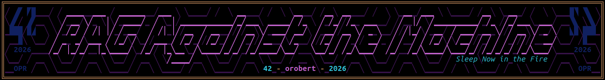
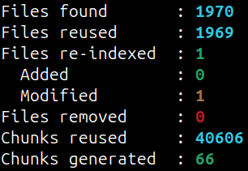
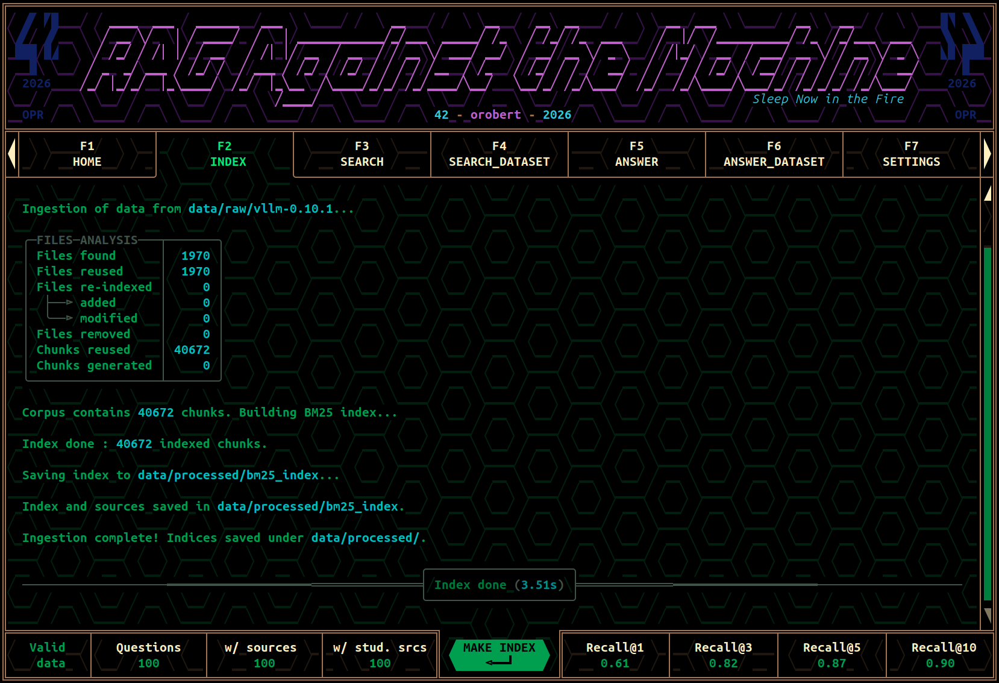
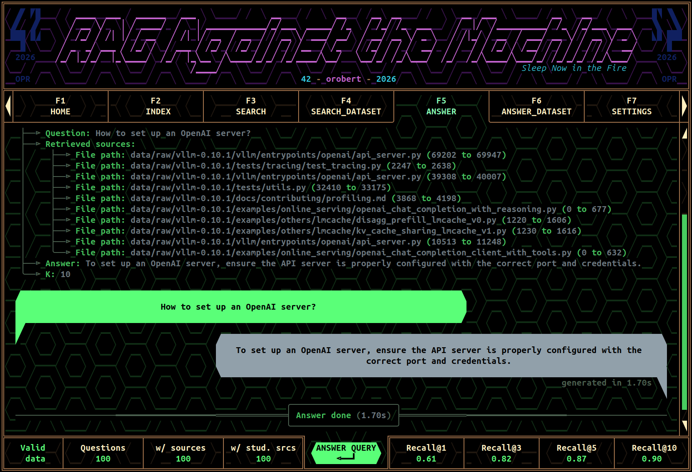
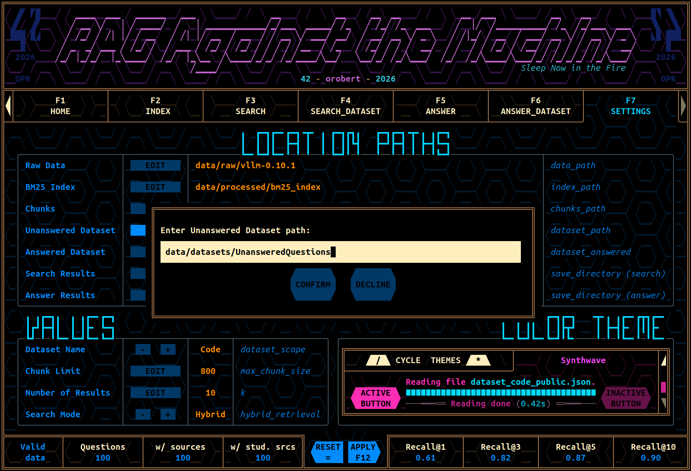
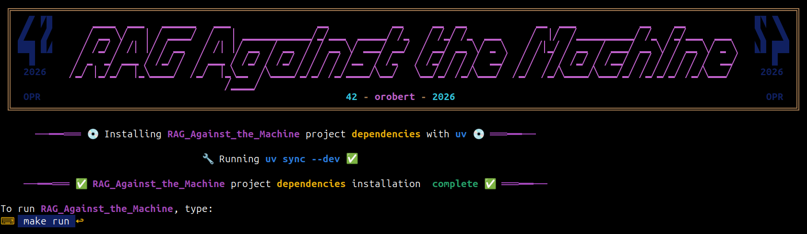
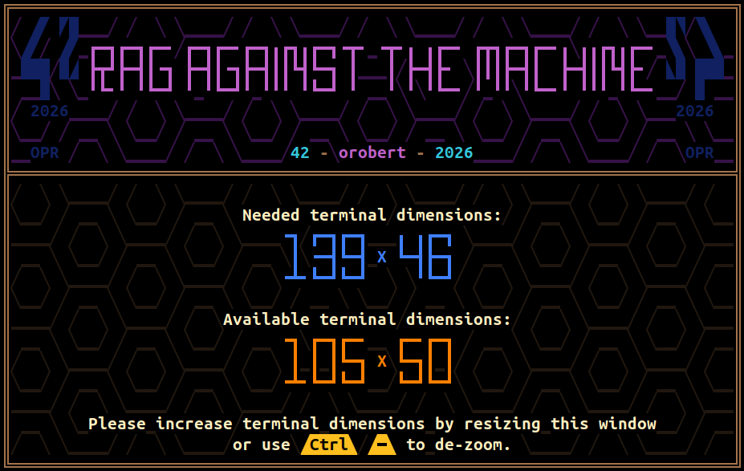
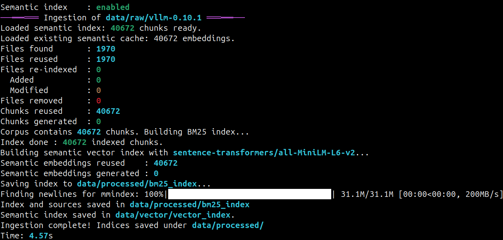
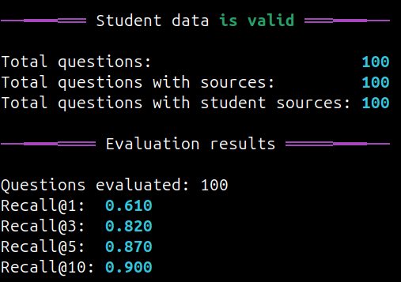
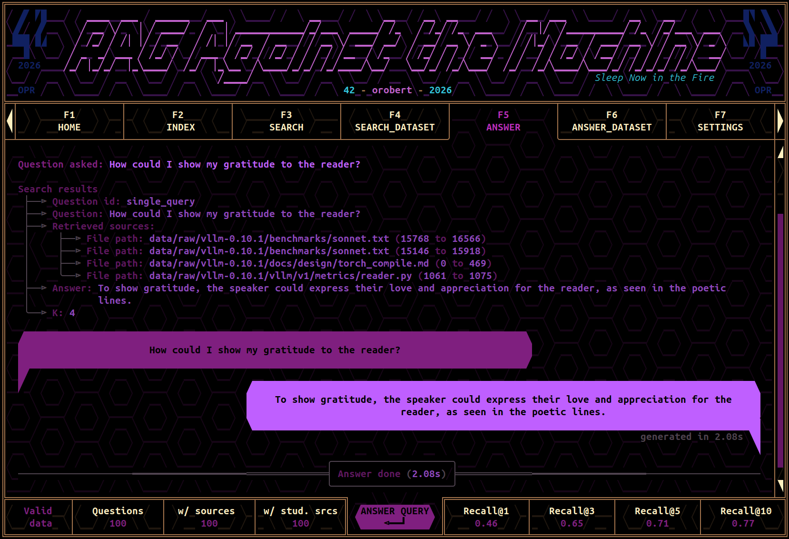

_This project has been created as part of the 42 curriculum by **orobert**._
<a id="top"></a>



$${\color{teal}⋘⊛⋙}$$

# **$${\color{orange}Table \space of \space Contents}$$**
- [1. Description](#description)
  - [1.1. Context](#description.context)
  - [1.2. Purpose](#description.purpose)
- [2. System Architecture](#system_architecture)
  - [2.1. Global View](#system_architecture.global_view)
  - [2.2. Main Components](#system_architecture.main_components)
  - [2.3. Project Layout](#system_architecture.project_layout)
- [3. Chunking Strategy](#chunking_strategy)
  - [3.1. Python Source Code](#chunking_strategy.python_source_code)
    - [3.1.1. Symbol Extraction](#chunking_strategy.python_source_code.symbol_extraction)
  - [3.2. Markdown Documentation](#chunking_strategy.markdown_documentation)
  - [3.3. Plain Text](#chunking_strategy.plain_text)
  - [3.4. File Path Enrichment](#chunking_strategy.file_path_enrichment)
  - [3.5. Stable Source Locations](#chunking_strategy.stable_source_locations)
- [4. Retrieval Methods](#retrieval_methods)
  - [4.1. BM25 Lexical Retrieval](#retrieval_methods.bm25_lexical_retrieval)
    - [4.1.1. Query Expansion](#retrieval_methods.bm25_lexical_retrieval.query_expansion)
    - [4.1.2. AST Symbol Bonus](#retrieval_methods.bm25_lexical_retrieval.ast_symbol_bonus)
    - [4.1.3. Documentation Bonus](#retrieval_methods.bm25_lexical_retrieval.documentation_bonus)
    - [4.1.4. Query Cache](#retrieval_methods.bm25_lexical_retrieval.query_cache)
  - [4.2. Semantic Retrieval](#retrieval_methods.semantic_retrieval)
  - [4.3. FAISS Vector Index](#retrieval_methods.faiss_vector_index)
  - [4.4. Hybrid Retrieval](#retrieval_methods.hybrid_retrieval)
  - [4.5. Candidate Selection](#retrieval_methods.candidate_selection)
  - [4.6. Graceful Fallback](#retrieval_methods.graceful_fallback)
- [5. Incremental Indexing and Caching](#incremental_indexing_and_caching)
  - [5.1. Repository Manifest](#incremental_indexing_and_caching.repository_manifest)
  - [5.2. Incremental Chunk Generation](#incremental_indexing_and_caching.incremental_chunk_generation)
  - [5.3. Semantic Embedding Cache](#incremental_indexing_and_caching.semantic_embedding_cache)
  - [5.4. Query Cache](#incremental_indexing_and_caching.query_cache)
  - [5.5. Atomic Persistence](#incremental_indexing_and_caching.atomic_persistence)
  - [5.6. Generated Data](#incremental_indexing_and_caching.generated_data)
- [6. Answer Generation](#answer_generation)
  - [6.1. Context Construction](#answer_generation.context_construction)
  - [6.2. Grounded Answers](#answer_generation.grounded_answers)
  - [6.3. Preventing Hallucinations](#answer_generation.preventing_hallucinations)
- [7. Interactive Terminal Interface](#interactive_terminal_interface)
  - [7.1. Philosophy](#interactive_terminal_interface.philosophy)
  - [7.2. Seven Dedicated Tabs](#interactive_terminal_interface.seven_dedicated_tabs)
  - [7.3. Persistent Logbooks](#interactive_terminal_interface.persistent_logbooks)
  - [7.4. Event-Based Rendering](#interactive_terminal_interface.event-based_rendering)
  - [7.5. Configuration](#interactive_terminal_interface.configuration)
  - [7.6. Color Themes](#interactive_terminal_interface.color_themes)
  - [7.7. Unicode Rendering](#interactive_terminal_interface.unicode_rendering)
- [8. Instructions](#instructions)
  - [8.1. Requirements](#instructions.requirements)
  - [8.2. Installation](#instructions.installation)
  - [8.3. Running the Interface](#instructions.running_the_interface)
  - [8.4. Building the Indices](#instructions.building_the_indices)
  - [8.5. Searching](#instructions.searching)
  - [8.6. Generating an Answer](#instructions.generating_an_answer)
  - [8.7. Processing an Entire Dataset](#instructions.processing_an_entire_dataset)
  - [8.8. Evaluation](#instructions.evaluation)
  - [8.9. Local HTTP API](#instructions.local_http_api)
- [9. Performance Analysis](#performance_analysis)
  - [9.1. Corpus Size](#performance_analysis.corpus_size)
  - [9.2. Index Construction](#performance_analysis.index_construction)
  - [9.3. Retrieval Performance](#performance_analysis.retrieval_performance)
  - [9.4. Recall@k](#performance_analysis.recall@k)
  - [9.5. Observations](#performance_analysis.observations)
- [10. Design Decisions](#design_decisions)
  - [10.1. Why BM25?](#design_decisions.why_bm25)
  - [10.2. Why Semantic Retrieval?](#design_decisions.why_semantic_retrieval)
  - [10.3. Why Reciprocal Rank Fusion?](#design_decisions.why_reciprocal_rank_fusion)
  - [10.4. Why Incremental Indexing?](#design_decisions.why_incremental_indexing)
  - [10.5. Why Three Interfaces?](#design_decisions.why_three_interfaces)
  - [10.6. Why a Custom Terminal Interface?](#design_decisions.why_a_custom_terminal_interface)
- [11. Challenges Faced](#challenges_faced)
  - [11.1. Finding Good Chunk Boundaries](#challenges_faced.finding_good_chunk_boundaries)
  - [11.2. Keeping Two Indices Synchronized](#challenges_faced.keeping_two_indices_synchronized)
  - [11.3. Long Semantic Indexing](#challenges_faced.long_semantic_indexing)
  - [11.4. Cache Compatibility](#challenges_faced.cache_compatibility)
  - [11.5. User Experience](#challenges_faced.user_experience)
- [12. Bonus Features](#bonus_features)
- [13. Resources](#resources)
- [14. AI Usage](#ai_usage)
- [15. Final Thoughts](#final_thoughts)
- [16. Contributors](#contributors)

$${\color{teal}⋘⊛⋙}$$
<a id="description"></a>

# **$${\color{orange}1. \space Description}$$**
<details><summary><strong>Section Contents 🗂️</strong></summary>

- [1.1. Context](#description.context)
- [1.2. Purpose](#description.purpose)
</details>

# [◀️](#top)&nbsp;&nbsp;&nbsp;[⏫](#top)&nbsp;&nbsp;&nbsp;[▶️](#system_architecture)
<a id="description.context"></a>

## **$${\color{violet}1.1. \space Context}$$**

> **Turning nearly three thousand source files into a local assistant.**

Large Language Models are remarkably good at reasoning from the information they receive, yet they remain fundamentally limited by the knowledge available inside their context window. No matter how capable a model may be, it cannot accurately answer questions about code it has never seen.

Retrieval-Augmented Generation (**RAG**) addresses this limitation by retrieving the most relevant pieces of information before asking the language model to generate an answer.

This project applies that idea to the **vLLM 0.10.1** codebase.

Starting from nearly **3,000 source files**, it builds a searchable knowledge base capable of answering technical questions while citing the exact source locations used to produce every answer.

Unlike a traditional chatbot, the model is never expected to invent information. Instead, it receives carefully selected fragments of the repository and is instructed to answer **only** from that context.

The result is a fully local Retrieval-Augmented Generation system featuring:

- lexical retrieval using **BM25**
- semantic retrieval using **Sentence Transformers**
- hybrid ranking through **Reciprocal Rank Fusion**
- incremental indexing
- persistent embedding and query caches
- grounded answer generation with **Qwen3-0.6B**
- automatic Recall@k evaluation
- a local HTTP API
- an interactive terminal interface
- configurable persistent settings
- sixteen integrated color themes

Although developed as part of the **42 curriculum**, the project progressively evolved far beyond the initial mandatory requirements into a complete documentation search engine designed to explore, index and understand large software repositories.

<a id="description.purpose"></a>

## **$${\color{violet}1.2. \space Purpose}$$**
The purpose of this project is to transform a software repository into a searchable knowledge base.

Instead of asking a Large Language Model to answer directly from its internal knowledge, the application first retrieves the most relevant parts of the repository and injects them into the prompt.

The language model therefore answers from **real project data** instead of relying on memory or hallucination.

The complete pipeline is composed of four successive stages:

1. **Indexing**\
   The repository is scanned, supported files are identified, and their contents are divided into meaningful chunks.

2. **Retrieval**\
   The chunks most relevant to the user's question are retrieved using lexical search, semantic search, or both.

3. **Augmentation**\
   The retrieved chunks are assembled into a compact context while preserving their exact source locations.

4. **Generation**\
   A local Qwen3 language model generates an answer strictly grounded in the retrieved context.

Because every retrieved chunk preserves its original file path and character offsets, the generated answer can always be traced back to the repository.\
The project intentionally keeps every processing step local.\
No external API is required for indexing, retrieval or answer generation.

$${\color{teal}⋘⊛⋙}$$
<a id="system_architecture"></a>

# **$${\color{orange}2. \space System \space Architecture}$$**
<details><summary><strong>Section Contents 🗂️</strong></summary>

- [2.1. Global View](#system_architecture.global_view)
- [2.2. Main Components](#system_architecture.main_components)
- [2.3. Project Layout](#system_architecture.project_layout)
</details>

# [◀️](#description)&nbsp;&nbsp;&nbsp;[⏫](#top)&nbsp;&nbsp;&nbsp;[▶️](#chunking_strategy)
<a id="system_architecture.global_view"></a>

## **$${\color{violet}2.1. \space Global \space View}$$**
The application is divided into several independent components.\
Each one has a single responsibility and communicates through strongly typed Pydantic models.

```text
                      Repository
                           │
              Incremental Repository Scan
                           │
               Python / Markdown Chunkers
                           │
                 Unified Chunk Corpus
                           │
            ┌──────────────┴──────────────┐
            │                             │
     BM25 Search Engine          Vector Search Engine
            │                             │
            └──────────────┬──────────────┘
                           │
                Hybrid Retrieval Engine
               (Reciprocal Rank Fusion)
                           │
                Top-k Retrieved Chunks
                           │
               ┌───────────┴───────────┐
               │                       │
       Structured Search       Local Qwen3-0.6B
               │                       │
      Search Results JSON      Generated Answer
               │                       │
               └───────────┬───────────┘
                           │
                  CLI • TUI • HTTP API
```

The architecture deliberately separates indexing, retrieval and generation.\
This makes every stage independently testable and allows the retrieval engine to evolve without affecting the answer generation pipeline.
<a id="system_architecture.main_components"></a>

## **$${\color{violet}2.2. \space Main \space Components}$$**

| Component | Responsibility |
|-----------|----------------|
| **Ingest** | Repository discovery, manifest management and chunk generation |
| **SearchEngine** | BM25 lexical indexing and retrieval |
| **VectorSearchEngine** | Semantic embeddings and FAISS vector search |
| **HybridSearchEngine** | Reciprocal Rank Fusion between lexical and semantic retrieval |
| **CLI** | High-level orchestration of every project command |
| **Interface** | Interactive terminal user interface |
| **FastAPI** | Local HTTP API exposing search and answer endpoints |
| **Pydantic models** | Validation of every exchanged data structure |

The same processing pipeline is shared by all user interfaces.\
Whether the user launches a command from the CLI, the graphical terminal interface or the HTTP API, the same underlying code is executed.\
This guarantees identical behaviour regardless of the chosen interface.
<a id="system_architecture.project_layout"></a>

## **$${\color{violet}2.3. \space Project \space Layout}$$**

```text
.
├── data/
│   ├── config.ini
│   ├── datasets/
│   ├── output/
│   ├── processed/
│   ├── raw/
│   └── vector/
│
├── src/
│   ├── base/
│   ├── command/
│   ├── engine/
│   ├── interface/
│   └── __main__.py
│
├── md_pictures/
│
├── Makefile
├── pyproject.toml
├── mypy.ini
├── README.md
└── uv.lock
```

The project was intentionally organised around responsibilities rather than technologies.\
Every package represents one major aspect of the application:
- **base** contains shared models and utilities;
- **engine** implements indexing and retrieval;
- **command** exposes the CLI and HTTP API;
- **interface** contains the complete interactive terminal application.

This separation keeps the retrieval engines entirely independent from the presentation layer while making future extensions considerably easier.

$${\color{teal}⋘⊛⋙}$$
<a id="chunking_strategy"></a>

# **$${\color{orange}3. \space Chunking \space Strategy}$$**
<details><summary><strong>Section Contents 🗂️</strong></summary>

- [3.1. Python Source Code](#chunking_strategy.python_source_code)
- [3.2. Markdown Documentation](#chunking_strategy.markdown_documentation)
- [3.3. Plain Text](#chunking_strategy.plain_text)
- [3.4. File Path Enrichment](#chunking_strategy.file_path_enrichment)
- [3.5. Stable Source Locations](#chunking_strategy.stable_source_locations)
</details>

# [◀️](#system_architecture)&nbsp;&nbsp;&nbsp;[⏫](#top)&nbsp;&nbsp;&nbsp;[▶️](#retrieval_methods)

Retrieval quality depends far more on document segmentation than it first appears.\
A chunk that is too small loses context.\
A chunk that is too large introduces irrelevant information into the prompt.\
The objective is therefore to produce chunks that are:
- semantically coherent;
- small enough to fit comfortably inside the language model context;
- large enough to remain understandable;
- stable across successive indexing operations;
- reusable whenever the original file has not changed.

Unlike many introductory RAG implementations that simply split text every *N* characters, this project uses a dedicated chunking strategy for each supported file type.
<a id="chunking_strategy.python_source_code"></a>

## **$${\color{violet}3.1. \space Python \space Source \space Code}$$**
Python files are parsed with the standard `ast` module.

Instead of splitting the source blindly, the parser first identifies every top-level class and function before recovering their exact character positions inside the original file.\
The resulting chunks therefore correspond to logical software components rather than arbitrary pieces of text.
```text
scheduler.py

Imports

SchedulerConfig
───────────────

Scheduler
─────────

allocate_slots()
────────────────

schedule()
──────────

...
```

Large definitions exceeding the configured chunk size are recursively divided while preserving a configurable overlap between consecutive chunks.\
Whenever possible, a chunk therefore contains an entire function or class definition.\
If the parser encounters invalid Python syntax, the file is automatically processed as plain text instead of aborting the indexing process.\
This makes the ingestion stage robust against partially written or corrupted source files.
<a id="chunking_strategy.python_source_code.symbol_extraction"></a>

### **$${\color{lightgreen}3.1.1. \space Symbol \space Extraction}$$**
The AST traversal also extracts useful identifiers such as:
- class names;
- function names;
- method names.

These symbols are stored alongside every chunk.\
During lexical retrieval they provide an additional ranking signal.\
For example, the query
```text
SchedulerConfig
```
will also favour chunks whose extracted symbols contain that identifier, even if it appears only once inside the body of the source code.\
This lightweight heuristic noticeably improves identifier-oriented searches while preserving BM25 as the primary ranking mechanism.
<a id="chunking_strategy.markdown_documentation"></a>

## **$${\color{violet}3.2. \space Markdown \space Documentation}$$**
Markdown files are processed differently.

Rather than treating them as plain text, the chunker preserves the document hierarchy defined by headings.\
For example:
```markdown
# Serving

## OpenAI Compatible Server

### Authentication
```
becomes searchable as
```text
Serving
OpenAI Compatible Server
Authentication

<paragraph text...>
```
This additional context greatly improves retrieval because documentation often introduces terminology inside headings without repeating it throughout every paragraph.\
Large documentation sections are divided into overlapping chunks while preserving the active heading hierarchy.
<a id="chunking_strategy.plain_text"></a>

## **$${\color{violet}3.3. \space Plain \space Text}$$**
Other supported files are processed using a generic text chunker.

Instead of splitting at an arbitrary position, the algorithm attempts to end a chunk at the nearest natural boundary.\
Typical candidates include:
- blank lines;
- paragraph separators;
- line breaks;
- whitespace;
- punctuation.

This considerably improves readability compared to a strict fixed-width split.

The generic text strategy is used for files such as:
- `.txt`
- `.rst`
- `Dockerfile`
- `Makefile`
<a id="chunking_strategy.file_path_enrichment"></a>

## **$${\color{violet}3.4. \space File \space Path \space Enrichment}$$**
The repository structure itself contains valuable information.

A user asking
> "How does the scheduler work?"

may never explicitly mention that the implementation resides inside
```text
vllm/core/scheduler.py
```
For this reason, every indexed chunk is enriched with keywords extracted from its own path.\
For example
```text
data/raw/vllm-0.10.1/docs/features/tool_calling.md
```
contributes searchable terms such as
```text
docs
features
tool
calling
```
without modifying the original source content.\
This simple enrichment noticeably improves searches referring to modules, directories or documented features.
<a id="chunking_strategy.stable_source_locations"></a>

## **$${\color{violet}3.5. \space Stable \space Source \space Locations}$$**
Every generated chunk permanently stores:
```python
file_path
first_character_index
last_character_index
```
Those values are never approximated.\
They correspond exactly to the original repository.\
This precision serves two purposes.\
First, generated answers can always reference the exact location from which their information originated.\
Second, the official evaluator compares these locations against the expected dataset.\
Using precise character offsets therefore becomes a functional requirement rather than a convenience.

$${\color{teal}⋘⊛⋙}$$
<a id="retrieval_methods"></a>

# **$${\color{orange}4. \space Retrieval \space Method}$$**
<details><summary><strong>Section Contents 🗂️</strong></summary>

- [4.1. BM25 Lexical Retrieval](#retrieval_methods.bm25_lexical_retrieval)
- [4.2. Semantic Retrieval](#retrieval_methods.semantic_retrieval)
- [4.3. FAISS Vector Index](#retrieval_methods.faiss_vector_index)
- [4.4. Hybrid Retrieval](#retrieval_methods.hybrid_retrieval)
- [4.5. Candidate Selection](#retrieval_methods.candidate_selection)
- [4.6. Graceful Fallback](#retrieval_methods.graceful_fallback)
</details>

# [◀️](#chunking_strategy)&nbsp;&nbsp;&nbsp;[⏫](#top)&nbsp;&nbsp;&nbsp;[▶️](#incremental_indexing_and_caching)
Once every chunk has been indexed, the repository becomes searchable.

The project currently provides three retrieval modes:
- BM25 lexical retrieval;
- semantic vector retrieval;
- hybrid retrieval combining both approaches.
Each engine has different strengths, and none attempts to replace the others.
<a id="retrieval_methods.bm25_lexical_retrieval"></a>

## **$${\color{violet}4.1. \space BM25 \space Lexical \space Retrieval}$$**
The mandatory retrieval engine is implemented with **BM25**.

Unlike a simple keyword search, BM25 evaluates each chunk according to several criteria, including:
- query term frequency;
- inverse document frequency;
- document length normalisation.

This makes it particularly effective for software repositories, where identifiers and technical terminology often provide extremely strong lexical signals.

Questions such as
```text
How does SchedulerConfig work?
```
are generally answered very accurately by lexical retrieval alone.
<a id="retrieval_methods.bm25_lexical_retrieval.query_expansion"></a>

### **$${\color{lightgreen}4.1.1. \space Query \space Expansion}$$**
Certain technical expressions appear under several different forms throughout the repository.

For example:
```text
kv cache
```
may also be written as
```text
key value cache
```
Instead of forcing the user to know the exact wording used by the project, selected concepts can be expanded automatically before retrieval.\
The original query always remains dominant.\
Expanded queries contribute with a deliberately smaller weight so that retrieval quality improves without overwhelming the user's actual wording.
<a id="retrieval_methods.bm25_lexical_retrieval.ast_symbol_bonus"></a>

### **$${\color{lightgreen}4.1.2. \space AST \space Symbol \space Bonus}$$**
The previously extracted Python symbols are reused during retrieval.

If a query matches a stored symbol, an additional ranking bonus is applied.\
This improves searches involving:
- classes;
- functions;
- configuration structures;
- public APIs.

The bonus remains intentionally small so that BM25 still determines the overall ranking.
<a id="retrieval_methods.bm25_lexical_retrieval.documentation_bonus"></a>

### **$${\color{lightgreen}4.1.3. \space Documentation \space Bonus}$$**
Many technical questions naturally target documentation before implementation.

The retrieval engine can therefore apply a configurable score bonus to documentation chunks.\
This slightly favours explanatory documents over implementation details whenever both appear equally relevant.\
The feature can be disabled entirely when purely code-oriented searches are preferred.
<a id="retrieval_methods.bm25_lexical_retrieval.query_cache"></a>

### **$${\color{lightgreen}4.1.4. \space Query \space Cache}$$**
Lexical retrieval is already extremely fast.

Nevertheless, dataset evaluation repeatedly executes identical queries.\
To avoid recomputing the same rankings, search results may be cached on disk.\
The cache key includes every parameter capable of modifying the retrieval behaviour, including:
- query text;
- candidate count;
- expansion settings.

Cached results remain completely transparent to the rest of the application.
<a id="retrieval_methods.semantic_retrieval"></a>

## **$${\color{violet}4.2. \space Semantic \space Retrieval}$$**
Lexical similarity is not always sufficient.

Consider the following example.\
Question:
```text
How are pending requests chosen?
```
Repository:
```text
The scheduler selects waiting sequence groups...
```
Although both sentences describe the same concept, they share very few identical words.\
Pure BM25 retrieval may therefore rank the correct chunk lower than expected.\
Semantic retrieval addresses this limitation.\
Every chunk is converted into a numerical embedding using
```text
sentence-transformers/all-MiniLM-L6-v2
```
Queries are embedded with the same model before being compared against every indexed vector.\
Similarity search is performed locally with **FAISS**.\
Unlike BM25, semantic retrieval compares meanings rather than words.\
It therefore excels whenever equivalent ideas are expressed using different vocabulary.
<a id="retrieval_methods.faiss_vector_index"></a>

## **$${\color{violet}4.3. \space FAISS \space Vector \space Index}$$**
Semantic embeddings are stored inside a persistent FAISS index.

The project uses normalised vectors together with inner-product search, which becomes equivalent to cosine similarity after normalisation.\
The vector index is stored separately from the lexical index.\
This allows:

- optional semantic indexing;
- independent cache management;
- graceful degradation when semantic data is unavailable.

The lexical engine therefore remains fully usable on its own.
<a id="retrieval_methods.hybrid_retrieval"></a>

## **$${\color{violet}4.4. \space Hybrid \space Retrieval}$$**
Both retrieval engines possess complementary strengths.

Lexical search excels at finding exact identifiers.\
Semantic search excels at recognising similar ideas.\
Rather than choosing one over the other, the project combines both using **Reciprocal Rank Fusion (RRF).**\
Each engine independently retrieves a larger candidate set than ultimately requested.\
Instead of comparing raw scores—which have completely different numerical meanings—the final ranking depends only on the position reached inside each individual engine.\
For every retrieved result:
```text
RRF score = 1 / (k + rank)
```
The contributions from both engines are summed.\
Chunks consistently ranked well by both retrieval methods naturally rise toward the top of the final ranking.\
This strategy completely avoids the difficult problem of normalising BM25 scores and cosine similarities onto a common numerical scale.
<a id="retrieval_methods.candidate_selection"></a>

## **$${\color{violet}4.5. \space Candidate \space Selection}$$**
Hybrid retrieval intentionally requests more candidates than the final number returned to the user.

The candidate count is computed as:
```text
candidate_count = max(
    requested_results × multiplier,
    minimum_candidates
)
```
before being capped by the repository size.\
This wider initial selection gives Reciprocal Rank Fusion enough information to identify chunks performing reasonably well in both engines, even when they are not ranked first individually.\
In practice, this produces noticeably better Recall@5 and Recall@10 scores.
<a id="retrieval_methods.graceful_fallback"></a>

## **$${\color{violet}4.6. \space Graceful \space Fallback}$$**
Semantic indexing remains optional.

If the vector index is missing or incompatible, the application does **not** abort.\
Instead, it automatically falls back to BM25 retrieval while emitting a warning explaining the situation.
```text
Hybrid requested
        │
        ├── Semantic index available
        │           │
        │           ▼
        │     Hybrid Retrieval
        │
        └── Semantic index unavailable
                    │
                    ▼
             Warning + BM25
```
This behaviour ensures that every command remains usable even when semantic resources have not yet been generated.\
It also prevents accidental interruption of demonstrations or evaluations because of missing optional data.

$${\color{teal}⋘⊛⋙}$$
<a id="incremental_indexing_and_caching"></a>

# **$${\color{orange}5. \space Incremental \space Indexing \space and \space Caching}$$**
<details><summary><strong>Section Contents 🗂️</strong></summary>

- [5.1. Repository Manifest](#incremental_indexing_and_caching.repository_manifest)
- [5.2. Incremental Chunk Generation](#incremental_indexing_and_caching.incremental_chunk_generation)
- [5.3. Semantic Embedding Cache](#incremental_indexing_and_caching.semantic_embedding_cache)
- [5.4. Query Cache](#incremental_indexing_and_caching.query_cache)
- [5.5. Atomic Persistence](#incremental_indexing_and_caching.atomic_persistence)
- [5.6. Generated Data](#incremental_indexing_and_caching.generated_data)
</details>

# [◀️](#retrieval_methods)&nbsp;&nbsp;&nbsp;[⏫](#top)&nbsp;&nbsp;&nbsp;[▶️](#answer_generation)
Building a lexical index over approximately forty thousand chunks only takes a few seconds.

Building semantic embeddings, however, is significantly more expensive.\
On the reference machine used during development, a complete semantic build requires approximately **15 to 18 minutes**.\
Such a delay is perfectly acceptable the first time the repository is indexed, but quickly becomes frustrating during development, where only a handful of files usually change between two executions.\
One of the main objectives of this project therefore became reducing unnecessary work whenever possible.\
Rather than rebuilding everything, the application now rebuilds **only what has actually changed**.
<a id="incremental_indexing_and_caching.repository_manifest"></a>

## **$${\color{violet}5.1. \space Repository \space Manifest}$$**
The ingestion process begins by creating a persistent manifest describing the indexed repository.

Each supported file stores information allowing future indexing operations to determine whether the file has changed.\
Among the recorded information are:
- relative path;
- file size;
- modification timestamp;
- content hash;
- chunking parameters used during generation.

When a new indexing operation begins, the repository is scanned again and compared against the previous manifest.\
Every file therefore falls into one of four categories:
```text
Unchanged
Added
Modified
Removed
```
Only modified files require new chunk generation.\
Everything else can be reused directly.
<a id="incremental_indexing_and_caching.incremental_chunk_generation"></a>

## **$${\color{violet}5.2. \space Incremental \space Chunk \space Generation}$$**
Whenever a file has not changed, its previously generated chunks are loaded directly from disk.

Only newly created or modified files are parsed again.\
For example, after correcting a single function inside the repository, the indexing summary may look like this:



Instead of regenerating more than forty thousand chunks, only a few dozen require processing.\
The time saved during normal development rapidly becomes substantial.
<a id="incremental_indexing_and_caching.semantic_embedding_cache"></a>

## **$${\color{violet}5.3. \space Semantic \space Embedding \space Cache}$$**
Chunk reuse alone is not sufficient.

Even when the textual chunk already exists, semantic embeddings remain expensive to compute.\
Every generated chunk therefore receives a stable identifier based on:
- its file path;
- its character range;
- its textual content.

Whenever semantic indexing begins, previously generated embeddings are loaded from disk.\
If an identical chunk already exists, its embedding is immediately reused without calling the transformer model.\
Only genuinely new chunks require inference.\
Typical output therefore becomes:
```text
Embeddings reused          : 40606

Embeddings generated       : 67
```
As a consequence, rebuilding a hybrid index after modifying one file generally completes in only a few seconds instead of several minutes.
<a id="incremental_indexing_and_caching.query_cache"></a>

## **$${\color{violet}5.4. \space Query \space Cache}$$**
Dataset evaluation executes the same retrieval queries repeatedly.

Even though BM25 retrieval is already very fast, recomputing identical rankings remains unnecessary.\
The lexical engine therefore supports an optional persistent query cache.\
Each cache entry depends on:
- query text;
- candidate count;
- query expansion state.

Whenever the exact same retrieval request is executed again, cached rankings are returned immediately.\
This optimisation mainly benefits automated dataset evaluation while remaining completely transparent to the rest of the application.
<a id="incremental_indexing_and_caching.atomic_persistence"></a>

## **$${\color{violet}5.5. \space Atomic \space Persistence}$$**
Persistent data should never become corrupted because of an interrupted execution.

Every generated file is therefore written using the following strategy:
```text
Temporary file
        │
        ▼
Successful write
        │
        ▼
Atomic replacement
```
The application never overwrites an existing index until the replacement has been successfully written.\
Should indexing be interrupted unexpectedly, the previous index remains usable.
<a id="incremental_indexing_and_caching.generated_data"></a>

## **$${\color{violet}5.6. \space Generated \space Data}$$**
Several kinds of persistent data are produced during indexing.

### BM25
```text
BM25 index
Chunk metadata
Chunk texts
Repository manifest
```
### Semantic Retrieval
```text
FAISS index
Embeddings
Chunk identifiers
Metadata
```
### Optional Caches
```text
Query cache
Embedding cache
```
Because every generated artifact can be recreated from the original repository, none of these files are considered authoritative.\
Deleting them only requires rebuilding the indices.

$${\color{teal}⋘⊛⋙}$$
<a id="answer_generation"></a>

# **$${\color{orange}6. \space Answer \space Generation}$$**
<details><summary><strong>Section Contents 🗂️</strong></summary>

- [6.1. Context Construction](#answer_generation.context_construction)
- [6.2. Grounded Answers](#answer_generation.grounded_answers)
- [6.3. Preventing Hallucinations](#answer_generation.preventing_hallucinations)
</details>

# [◀️](#incremental_indexing_and_caching)&nbsp;&nbsp;&nbsp;[⏫](#top)&nbsp;&nbsp;&nbsp;[▶️](#interactive_terminal_interface)
Retrieval alone is not the objective of a Retrieval-Augmented Generation system.

Once the most relevant chunks have been selected, they must be transformed into a context suitable for a language model.\
This project uses **Qwen/Qwen3-0.6B** running entirely locally.
<a id="answer_generation.context_construction"></a>

## **$${\color{violet}6.1. \space Context \space Construction}$$**
After retrieval, the selected chunks are concatenated into a structured context.

Each retrieved fragment preserves:
- its source file;
- its character positions;
- its textual content.

The resulting prompt therefore resembles:
```text
     Question
        ↓
Retrieved sources
        ↓
   Instructions
        ↓
      Answer
```
Only the retrieved context is provided to the language model.\
The model is explicitly instructed not to rely on external knowledge.
<a id="answer_generation.grounded_answers"></a>

## **$${\color{violet}6.2. \space Grounded \space Answers}$$**
A generated answer is expected to satisfy three properties.

### Correctness
The answer should faithfully reflect the retrieved documentation or source code.

### Traceability
Every statement should originate from one or more retrieved chunks.

### Conciseness
The language model should answer the user's question rather than summarising every retrieved document.

The objective is not to produce the longest possible answer, but the most useful one.
<a id="answer_generation.preventing_hallucinations"></a>

## **$${\color{violet}6.3. \space Preventing \space Hallucinations}$$**
One of the main challenges of RAG systems is preventing the language model from inventing information.\
Several mechanisms contribute to reducing this risk.

### Restricted Prompt
The model receives explicit instructions to answer **only** from the supplied context.

### Limited Context
Only the highest-ranked chunks are included.\
Irrelevant information is therefore less likely to influence the answer.

### Optional BM25 Relevance Check
Lexical retrieval scores provide an approximate indication of confidence.\
When BM25 is used alone, extremely weak retrieval results may therefore trigger a dedicated response such as:
> *No sufficiently relevant information was found.*
instead of forcing the language model to generate an uncertain answer.\
Because Reciprocal Rank Fusion produces scores on a completely different numerical scale, this heuristic is intentionally disabled for hybrid retrieval.

$${\color{teal}⋘⊛⋙}$$
<a id="interactive_terminal_interface"></a>

# **$${\color{orange}7. \space Interactive \space Terminal \space Interface}$$**
<details><summary><strong>Section Contents 🗂️</strong></summary>

- [7.1. Philosophy](#interactive_terminal_interface.philosophy)
- [7.2. Seven Dedicated Tabs](#interactive_terminal_interface.seven_dedicated_tabs)
- [7.3. Persistent Logbooks](#interactive_terminal_interface.persistent_logbooks)
- [7.4. Event-Based Rendering](#interactive_terminal_interface.event-based_rendering)
- [7.5. Configuration](#interactive_terminal_interface.configuration)
- [7.6. Color Themes](#interactive_terminal_interface.color_themes)
- [7.7. Unicode Rendering](#interactive_terminal_interface.unicode_rendering)
</details>

# [◀️](#answer_generation)&nbsp;&nbsp;&nbsp;[⏫](#top)&nbsp;&nbsp;&nbsp;[▶️](#instructions)
Although every feature of the project is available from the command line, repeatedly executing long commands quickly becomes cumbersome.

One of the most distinctive parts of this project is therefore its fully interactive terminal interface.\
Rather than acting as a separate implementation, the interface is simply another front-end built on top of the same CLI methods.\
Every action performed from the interface ultimately calls the same functions used by Python Fire and the HTTP API.\
This guarantees identical behaviour regardless of the chosen interface.


<a id="interactive_terminal_interface.philosophy"></a>

## **$${\color{violet}7.1. \space Philosophy}$$**
The interface was designed around one guiding principle:

> **Every long-running operation should be observable.**

Instead of displaying isolated status messages, the application records every significant event inside persistent logbooks.

The user can therefore review:

- indexing operations;
- search results;
- generated answers;
- evaluation summaries;
- warnings;
- errors;
- progress bars.

at any time during the session.

Nothing disappears once printed.
<a id="interactive_terminal_interface.seven_dedicated_tabs"></a>

## **$${\color{violet}7.2. \space Seven \space Dedicated \space Tabs}$$**

The application separates its features into seven independent workspaces.

| Tab | Purpose |
|------|---------|
| Home | Project overview and maintenance |
| Index | Repository ingestion and index construction |
| Search | Single-query retrieval |
| Search Dataset | Batch retrieval |
| Answer | Single-question generation |
| Answer Dataset | Batch answer generation |
| Settings | Persistent configuration |

Function keys and horizontal arrow keys allow direct navigation between tabs, while vertical arrow keys provide scrolling inside the current logbook.
<a id="interactive_terminal_interface.persistent_logbooks"></a>

## **$${\color{violet}7.3. \space Persistent \space Logbooks}$$**
Every command owns its own history.

Launching an indexing operation does not erase previous search results.\
Each processing tab therefore behaves almost like an independent terminal window dedicated to one specific task.\
This considerably improves usability during experimentation and debugging.
<a id="interactive_terminal_interface.event-based_rendering"></a>

## **$${\color{violet}7.4. \space Event-Based \space Rendering}$$**
The interface does not print plain text directly.

Instead, every important action generates a structured event.\
Typical events include:

- informational messages;
- warnings;
- errors;
- progress updates;
- search results;
- answer bubbles;
- evaluation summaries.

The interface simply renders these events according to their type.

This separation keeps the business logic entirely independent from presentation concerns while making future interface improvements considerably easier.


<a id="interactive_terminal_interface.configuration"></a>

## **$${\color{violet}7.5. \space Configuration}$$**
Every configurable parameter is available directly from the interface.

Unlike many command-line tools, no manual edition of configuration files is required during normal use.\n
Among the configurable parameters are:

- repository path;
- BM25 index location;
- semantic index location;
- chunk directory;
- datasets;
- output directories;
- maximum chunk size;
- number of retrieved results;
- retrieval engine;
- color theme.

The current configuration is automatically stored inside:
```text
data/config.ini
```
and restored during the next execution.

The interface therefore remembers the user's preferred working environment between sessions.


<a id="interactive_terminal_interface.color_themes"></a>

## **$${\color{violet}7.6. \space Color \space Themes}$$**
Although entirely optional from a functional point of view, the interface supports **16** complete color themes.

Originally introduced simply to improve readability, they gradually became one of the most appreciated aspects of the application.\n
Themes can be previewed directly inside the Settings tab without leaving the interface.\n

Navigation simply cycles through the available themes using __/__ and __*__ keys.

```text
    Matrix ───────── Volcano ────── Retina Break ────── Canopy ────╮
      │                                                            │
  IBM's CGA    ╭─── Vault Tec ─────── Nuka Cola ────── Deep Blue ──╯
      │        │
Weyland-Yutani ╰─ Dry Grassland ──── Witch Lace ───── Gingerbread ─╮
      │                                                            │
  Synthwave ────── T.A.R.D.I.S ──── GLaDOS Legacy ──── Lemonade ───╯
```

Because every theme is built from semantic color roles rather than hard-coded values, changing theme immediately affects the entire application.


<a id="interactive_terminal_interface.unicode_rendering"></a>

## **$${\color{violet}7.7. \space Unicode \space Rendering}$$**
Supporting Unicode inside a terminal may appear straightforward until double-width characters enter the picture.

Several decorative characters used throughout the interface occupy two terminal cells instead of one.\
The rendering engine therefore keeps track of continuation cells so that every subsequent drawing operation preserves correct alignment.\
Without this mechanism, borders, progress bars and tables would gradually drift out of alignment.\
Although invisible to the user, this represents one of the most technically demanding parts of the interface implementation.

$${\color{teal}⋘⊛⋙}$$
<a id="instructions"></a>

# **$${\color{orange}8. \space Instructions}$$**
<details><summary><strong>Section Contents 🗂️</strong></summary>

- [8.1. Requirements](#instructions.requirements)
- [8.2. Installation](#instructions.installation)
- [8.3. Running the Interface](#instructions.running_the_interface)
- [8.4. Building the Indices](#instructions.building_the_indices)
- [8.5. Searching](#instructions.searching)
- [8.6. Generating an Answer](#instructions.generating_an_answer)
- [8.7. Processing an Entire Dataset](#instructions.processing_an_entire_dataset)
- [8.8. Evaluation](#instructions.evaluation)
- [8.9. Local HTTP API](#instructions.local_http_api)
</details>

# [◀️](#interactive_terminal_interface)&nbsp;&nbsp;&nbsp;[⏫](#top)&nbsp;&nbsp;&nbsp;[▶️](#performance_analysis)
<a id="instructions.requirements"></a>

## **$${\color{violet}8.1. \space Requirements}$$**
The project requires:

- Python 3.10 or later;
- `uv`;
- a terminal supporting ANSI escape sequences and Unicode;
- sufficient free disk space for the local model and Hugging Face cache.

A GPU is **not** required.\
Every feature of the project runs correctly on a CPU-only machine.
<a id="instructions.installation"></a>

## **$${\color{violet}8.2. \space Installation}$$**
Create the virtual environment and install every dependency.
```bash
uv sync
```
or
```bash
make install
```

<a id="instructions.running_the_interface"></a>

## **$${\color{violet}8.3. \space Running \space the \space Interface}$$**
```bash
uv run python -m src interface
```
or
```bash
make interface
```
The interactive interface is generally the easiest way to explore the project.\
The Launcher will ensure your Terminal is large enough to host the Interface.


<a id="instructions.building_the_indices"></a>

## **$${\color{violet}8.4. \space Building \space the \space Indices}$$**
**BM25 only**:

```bash
uv run python -m src index
```
or
```bash
make index
```

**Hybrid retrieval**:

```bash
uv run python -m src index --hybrid_retrieval=True
```
or
```bash
make index_hybrid
```
The first semantic indexing operation may require approximately fifteen minutes.\
Subsequent executions generally complete much faster thanks to embedding reuse.


<a id="instructions.searching"></a>

## **$${\color{violet}8.5. \space Searching}$$**
**BM25**:

```bash
uv run python -m src search \
    "How does vLLM schedule requests?"
```
or
```bash
make search
```

**Hybrid mode**:

```bash
uv run python -m src search "How does vLLM schedule requests?" --hybrid_retrieval=True
```
or
```bash
make search_hybrid
```
<a id="instructions.generating_an_answer"></a>

## **$${\color{violet}8.6. \space Generating \space an \space Answer}$$**

```bash
uv run python -m src answer \
    "How does vLLM schedule requests?"
```
or
```bash
make answer
```
or
```bash
make answer_hybrid
```
The command automatically retrieves the relevant context before querying the local language model.
<a id="instructions.processing_an_entire_dataset"></a>

## **$${\color{violet}8.7. \space Processing \space an \space Entire \space Dataset}$$**
Search:

```bash
uv run python -m src search_dataset
```
or
```bash
make search_dataset
```
or
```bash
make search_dataset_hybrid
```

Answer generation:

```bash
uv run python -m src answer_dataset
```
or
```bash
make answer_dataset
```
<a id="instructions.evaluation"></a>

## **$${\color{violet}8.8. \space Evaluation}$$**
The generated search results can be evaluated directly against the provided answered datasets.

```bash
uv run python -m src evaluate
```
or
```bash
make evaluate
```
The evaluator reports:

- Recall@1
- Recall@3
- Recall@5
- Recall@k

following the evaluation protocol defined by the project subject.


<a id="instructions.local_http_api"></a>

## **$${\color{violet}8.9. \space Local \space HTTP \space API}$$**
The project also exposes a lightweight REST API built with FastAPI.

Typical endpoints include:

```text
POST /search
POST /answer
```

Once started, the automatically generated documentation becomes available at:

```text
http://127.0.0.1:8000/docs
```

The API internally relies on the exact same retrieval pipeline used by the CLI and terminal interface.

To run the API:
```bash
uv run uvicorn src.api:app --reload
```
or
```bash
make start-api
```

$${\color{teal}⋘⊛⋙}$$
<a id="performance_analysis"></a>

# **$${\color{orange}9. \space Performance \space Analysis}$$**
<details><summary><strong>Section Contents 🗂️</strong></summary>

- [9.1. Corpus Size](#performance_analysis.corpus_size)
- [9.2. Index Construction](#performance_analysis.index_construction)
- [9.3. Retrieval Performance](#performance_analysis.retrieval_performance)
- [9.4. Recall@k](#performance_analysis.recall@k)
- [9.5. Observations](#performance_analysis.observations)
</details>

# [◀️](#instructions)&nbsp;&nbsp;&nbsp;[⏫](#top)&nbsp;&nbsp;&nbsp;[▶️](#design_decisions)
Performance was measured repeatedly throughout development.

Rather than focusing exclusively on execution speed, optimisation efforts primarily targeted development workflow.

Saving several minutes during every rebuild rapidly becomes more valuable than reducing the execution time of a single search query.
<a id="performance_analysis.corpus_size"></a>

## **$${\color{violet}9.1. \space Corpus \space Size}$$**
The reference repository currently contains approximately:

| Metric | Value |
|---------|------:|
| Source files | ~1,970 |
| Generated chunks | ~40,672 |

Exact values may vary slightly depending on repository updates.
<a id="performance_analysis.index_construction"></a>

## **$${\color{violet}9.2. \space Index \space Construction}$$**
Observed execution times on the reference development machine:

| Operation | Typical duration |
|-----------|-----------------:|
| Complete BM25 indexing | < 30 seconds |
| Incremental BM25 rebuild | ~3–5 seconds |
| Initial semantic indexing | ~15–18 minutes |
| Fully cached semantic rebuild | ~15 seconds |

The difference between the initial and cached semantic builds illustrates the importance of embedding reuse.
<a id="performance_analysis.retrieval_performance"></a>

## **$${\color{violet}9.3. \space Retrieval \space Performance}$$**
Searching the complete public documentation dataset:

| Engine | 100 queries |
|---------|------------:|
| BM25 | ~0.03 s |
| Hybrid | ~8 s |

Although semantic retrieval introduces a measurable cost, the overall execution time remains comfortably below the limits imposed by the project subject.
<a id="performance_analysis.recall@k"></a>

## **$${\color{violet}9.4. \space Recall@k}$$**
### On the public **documentation** dataset:

| Metric | BM25 | Hybrid |
|---------|------:|-------:|
| Recall@1 | 0.66 | 0.61 |
| Recall@3 | 0.81 | 0.82 |
| Recall@5 | 0.84 | 0.87 |
| Recall@10 | 0.89 | 0.90 |

### On the public **code** dataset:

| Metric | BM25 | Hybrid |
|---------|------:|-------:|
| Recall@1 | 0.46 | 0.40 |
| Recall@3 | 0.65 | 0.64 |
| Recall@5 | 0.71 | 0.74 |
| Recall@10 | 0.77 | 0.83 |

Hybrid retrieval slightly decreases Recall@1 while improving every larger retrieval depth.\
Because answer generation typically relies on several retrieved chunks rather than only the first one, improving Recall@5 and Recall@10 was considered the most meaningful objective.\
Both retrieval engines satisfy the mandatory Recall@5 requirement defined by the subject.
<a id="performance_analysis.observations"></a>

## **$${\color{violet}9.5. \space Observations}$$**
BM25 remains remarkably competitive on software repositories.

Semantic retrieval does not replace lexical retrieval.\
Instead, both approaches compensate for each other's weaknesses.\
The hybrid engine consistently provides the most balanced results across a wide range of questions.

$${\color{teal}⋘⊛⋙}$$
<a id="design_decisions"></a>

# **$${\color{orange}10. \space Design \space Decisions}$$**
<details><summary><strong>Section Contents 🗂️</strong></summary>

- [10.1. Why BM25?](#design_decisions.why_bm25)
- [10.2. Why Semantic Retrieval?](#design_decisions.why_semantic_retrieval)
- [10.3. Why Reciprocal Rank Fusion?](#design_decisions.why_reciprocal_rank_fusion)
- [10.4. Why Incremental Indexing?](#design_decisions.why_incremental_indexing)
- [10.5. Why Three Interfaces?](#design_decisions.why_three_interfaces)
- [10.6. Why a Custom Terminal Interface?](#design_decisions.why_a_custom_terminal_interface)
</details>

# [◀️](#performance_analysis)&nbsp;&nbsp;&nbsp;[⏫](#top)&nbsp;&nbsp;&nbsp;[▶️](#challenges_faced)
One of the most interesting aspects of this project was that very few implementation choices were made all at once.

Instead, the application progressively evolved as new problems appeared.\
Most of the current architecture is therefore the result of iterative improvements rather than an initial grand design.
<a id="design_decisions.why_bm25"></a>

## **$${\color{violet}10.1. \space Why \space BM25?}$$**
The project subject requires either TF-IDF or BM25.

BM25 was selected because software repositories naturally contain many repeated identifiers, configuration names and technical terms.\
Unlike dense semantic retrieval, lexical search rewards exact matches very efficiently.\
For software documentation, this often provides surprisingly strong retrieval quality while remaining extremely fast.\
Rather than replacing BM25, the rest of the project was designed to complement it.
<a id="design_decisions.why_semantic_retrieval"></a>

## **$${\color{violet}10.2. \space Why \space Semantic \space Retrieval?}$$**
Some questions simply do not share enough vocabulary with the source code.

For example:

```text
How are pending requests chosen?
```

may correspond to implementation comments discussing

```text
waiting sequence groups
```

Lexical retrieval alone cannot always bridge that vocabulary gap.\
Sentence embeddings solve precisely this problem.\
Instead of matching words, they compare meanings.\
Adding semantic retrieval therefore increased recall without affecting the mandatory lexical pipeline.
<a id="design_decisions.why_reciprocal_rank_fusion"></a>

## **$${\color{violet}10.3. \space Why \space Reciprocal \space Rank \space Fusion?}$$**
Combining two retrieval engines raises an immediate question:

How should their scores be compared?\
BM25 scores and cosine similarities have completely different numerical meanings.\
Trying to normalize them generally introduces more problems than it solves.\
Reciprocal Rank Fusion avoids this issue entirely.\
Instead of comparing scores, it compares rankings.\
A chunk that consistently appears near the top of both retrieval engines naturally receives a higher fused score than one performing well in only one engine.\
The resulting algorithm is remarkably simple, deterministic and robust.
<a id="design_decisions.why_incremental_indexing"></a>

## **$${\color{violet}10.4. \space Why \space Incremental \space Indexing?}$$**
During development, rebuilding the lexical index only required a few seconds.

Semantic indexing, however, required approximately fifteen minutes.\
Waiting that long after every small modification quickly became unacceptable.\
The solution was therefore not to optimise the embedding model itself, but to avoid recomputing embeddings whenever possible.\
By introducing:

- repository manifests;
- stable chunk identifiers;
- embedding reuse;

the effective semantic rebuild time dropped from several minutes to only a few seconds after ordinary source modifications.
<a id="design_decisions.why_three_interfaces"></a>

## **$${\color{violet}10.5. \space Why \space Three \space Interfaces?}$$**
The project exposes the same functionality through:

- a command-line interface;
- an interactive terminal application;
- a local HTTP API.

Each serves a different purpose.\
The CLI is ideal for scripting.\
The HTTP API allows integration with external tools.\
The interactive interface makes experimentation considerably more pleasant while providing continuous visual feedback.\
Despite their different appearances, all three ultimately execute the same internal methods.\
Maintaining a single processing pipeline significantly reduced maintenance complexity.
<a id="design_decisions.why_a_custom_terminal_interface"></a>

## **$${\color{violet}10.6. \space Why \space a \space Custom \space Terminal \space Interface?}$$**
Several existing libraries already provide terminal widgets.

Nevertheless, implementing a custom rendering engine offered complete control over:

- Unicode support;
- rendering performance;
- keyboard handling;
- visual consistency;
- persistent logbooks.

It also became an opportunity to reuse and extend components developed throughout previous projects of the 42 curriculum.\
The resulting interface eventually grew into a project of its own.

$${\color{teal}⋘⊛⋙}$$
<a id="challenges_faced"></a>

# **$${\color{orange}11. \space Challenges \space Faced}$$**
<details><summary><strong>Section Contents 🗂️</strong></summary>

- [11.1. Finding Good Chunk Boundaries](#challenges_faced.finding_good_chunk_boundaries)
- [11.2. Keeping Two Indices Synchronized](#challenges_faced.keeping_two_indices_synchronized)
- [11.3. Long Semantic Indexing](#challenges_faced.long_semantic_indexing)
- [11.4. Cache Compatibility](#challenges_faced.cache_compatibility)
- [11.5. User Experience](#challenges_faced.user_experience)
</details>

# [◀️](#design_decisions)&nbsp;&nbsp;&nbsp;[⏫](#top)&nbsp;&nbsp;&nbsp;[▶️](#bonus_features)

Every non-trivial feature introduced its own difficulties.

Several of them fundamentally changed the architecture of the application.
<a id="challenges_faced.finding_good_chunk_boundaries"></a>

## **$${\color{violet}11.1. \space Finding \space Good \space Chunk \space Boundaries}$$**
At first glance, chunking appears almost trivial.

Simply split every 800 characters.\
Reality proved quite different.\
Splitting a Python file in the middle of a function often separated the function signature from its implementation.\
Likewise, splitting documentation immediately after a heading removed the very context explaining the following paragraphs.

This gradually led to three dedicated chunkers:

- AST-aware Python chunking;
- Markdown-aware chunking;
- generic text chunking.

The resulting chunks are considerably more meaningful than fixed-width segments.
<a id="challenges_faced.keeping_two_indices_synchronized"></a>

## **$${\color{violet}11.2. \space Keeping \space Two \space Indices \space Synchronized}$$**
Hybrid retrieval assumes that lexical and semantic indices describe exactly the same corpus.

Even a single missing chunk would invalidate every subsequent ranking.\
The hybrid engine therefore performs extensive consistency checks before becoming operational.\
It verifies:

- chunk counts;
- source paths;
- character ranges;
- ordering.

Should any mismatch be detected, the application immediately reports the inconsistency instead of silently producing incorrect results.
<a id="challenges_faced.long_semantic_indexing"></a>

## **$${\color{violet}11.3. \space Long \space Semantic \space Indexing}$$**
The first complete semantic indexing operation remains the slowest step of the project.

Instead of attempting to hide that cost, the application focuses on ensuring that it almost never has to happen twice.\
Persistent embedding caches and incremental updates transform a one-time expense into an acceptable maintenance operation.
<a id="challenges_faced.cache_compatibility"></a>

## **$${\color{violet}11.4. \space Cache \space Compatibility}$$**
One interesting issue appeared during development after reorganising the source tree.

Previously generated pickle files still referenced:

```text
src.models
```

whereas the project had evolved toward:

```text
src.base.models
```

Because pickle stores module paths together with serialized objects, the cached indices became incompatible.\
Rather than introducing unnecessary migration code, the solution was simply to regenerate the caches.\
This reinforced an important design principle:

> Generated data should always be considered disposable.

The repository itself remains the only authoritative source.
<a id="challenges_faced.user_experience"></a>

## **$${\color{violet}11.5. \space User \space Experience}$$**
The project originally focused almost exclusively on retrieval quality.

As development progressed, attention gradually shifted toward usability.\
Numerous small improvements eventually accumulated:

- persistent settings;
- graceful fallback from hybrid retrieval to BM25;
- progress visualization;
- dedicated logbooks;
- scrollable outputs;
- answer bubbles;
- color themes.

None of these features directly improve retrieval quality.\
Together, however, they transform the application into a significantly more pleasant tool to use.

$${\color{teal}⋘⊛⋙}$$
<a id="bonus_features"></a>

# **$${\color{orange}12. \space Bonus \space Features}$$**
# [◀️](#challenges_faced)&nbsp;&nbsp;&nbsp;[⏫](#top)&nbsp;&nbsp;&nbsp;[▶️](#resources)
Every bonus proposed by the project subject has been implemented and has been demonstrated by the usages described previously.

| Bonus | Implementation | Succeed |
|-------|----------------|---------|
| Semantic retrieval | Sentence Transformers + FAISS |    ✅    |
| Hybrid search | Reciprocal Rank Fusion |    ✅    |
| Incremental indexing | Manifest-based selective rebuilding |    ✅    |
| Persistent caches | Query cache + embedding cache |    ✅    |
| HTTP API | FastAPI |    ✅    |

Several additional features not explicitly requested by the subject were also developed, including:

- interactive terminal interface;
- persistent configuration;
- automatic BM25 fallback;
- AST-aware symbol extraction;
- Markdown hierarchy preservation;
- deterministic hybrid ranking.

$${\color{teal}⋘⊛⋙}$$
<a id="resources"></a>

# **$${\color{orange}13. \space Resources}$$**
# [◀️](#bonus_features)&nbsp;&nbsp;&nbsp;[⏫](#top)&nbsp;&nbsp;&nbsp;[▶️](#ai_usage)
## Retrieval-Augmented Generation

- [Retrieval-Augmented Generation for Knowledge-Intensive NLP Tasks](https://arxiv.org/abs/2005.11401)
- [LangChain documentation](https://langchain-doc.readthedocs.io/en/latest/index.html)
- [LlamaIndex documentation](https://developers.llamaindex.ai/python/framework/)

## Information Retrieval

- [BM25 documentation](https://huggingface.co/blog/xhluca/bm25s)
- [FAISS documentation](https://faiss.ai/index.html)

## Machine Learning

- [Sentence Transformers](https://sbert.net/)
- [Hugging Face Transformers](https://huggingface.co/sentence-transformers)
- [Qwen3 model documentation](https://huggingface.co/docs/transformers/model_doc/qwen3)

## Python

- [Python Fire](https://github.com/google/python-fire)
- [FastAPI](https://fastapi.tiangolo.com/)

## Reusable code
- **Canvas** and **Colors** methods from _A-Maze-ing_, _Fly-In_ and _Call_ _me_ _Maybe_ projects
- **Terminal** and **key control** methods from _Fly-In_ and _Call_ _me_ _Maybe_ projects
- **LogBook** methods from _Call_ _me_ _Maybe_ project
Each being upgraded for every project it's been used for


$${\color{teal}⋘⊛⋙}$$
<a id="ai_usage"></a>

# **$${\color{orange}14. \space AI \space Usage}$$**
# [◀️](#resources)&nbsp;&nbsp;&nbsp;[⏫](#top)&nbsp;&nbsp;&nbsp;[▶️](#final_thoughts)
Artificial Intelligence was used throughout the project as an engineering assistant rather than as an automatic code generator.

Typical uses included:

- discussing architectural choices;
- explaining retrieval algorithms;
- reviewing implementations;
- identifying edge cases;
- suggesting alternative approaches;
- reviewing documentation;
- proofreading docstrings;
- improving error handling.

Every significant modification proposed by the AI was manually reviewed, adapted, integrated and tested before being accepted.\
Conversely, many suggestions were intentionally rejected whenever they conflicted with the project's architecture or design philosophy.\
The final implementation, integration choices and validation remain entirely the responsibility of the project author.

$${\color{teal}⋘⊛⋙}$$
<a id="final_thoughts"></a>

# **$${\color{orange}15. \space Final \space Thoughts}$$**
# [◀️](#ai_usage)&nbsp;&nbsp;&nbsp;[⏫](#top)&nbsp;&nbsp;&nbsp;[▶️](#contributors)
The initial objective of this project was to build a Retrieval-Augmented Generation pipeline capable of answering questions about a software repository.

Along the way, it gradually became something larger.\
The project now combines:

- incremental repository analysis;
- lexical and semantic information retrieval;
- deterministic hybrid ranking;
- local language-model inference;
- structured evaluation;
- three complementary user interfaces.

Every new feature originated from the same simple question:

> *How can this system become faster, more reliable or more pleasant to use without sacrificing simplicity?*

Looking back, the answer was rarely to add complexity.\
More often, it was to improve the interaction between already existing components.\
That philosophy ultimately shaped the entire architecture of the project.\
Although developed within the constraints of the 42 curriculum, the resulting application aims to demonstrate a broader idea:

> **A good RAG system is not only about generating answers. It is about building enough confidence in the retrieved information that those answers become trustworthy.**

$${\color{teal}⋘⊛⋙}$$
<a id="contributors"></a>

# **$${\color{orange}16. \space Contributors}$$**
# [◀️](#final_thoughts)&nbsp;&nbsp;&nbsp;[⏫](#top)&nbsp;&nbsp;&nbsp;[▶️](#bottom)
- **orobert** aka **_OPR_**\
    _**RAG Against the Machine** project_
- **ChatGPT**\
    _explanations on how-to, debugging, suggestions_
- **Students** from **School 42 Mulhouse**\
    _brainstorming, coffee and moral support_

$${\color{teal}⋘⊛⋙}$$
<a id="bottom"></a>

# **$${\color{magenta}Thanks \space for \space your \space time}$$**


$${\color{teal}⋘⊛⋙}$$

###### $${\color{darkgrey}_i\space_f\space\space\space_y\space_o\space_u\space\space\space_c\space_a\space_n\space\space\space_r\space_e\space_a\space_d\space\space\space_t\space_h\space_i\space_s\space_,\space\space\space_y\space_o\space_u\space\space\space_d\space_o\space_n\space_`\space_t\space\space\space_n\space_e\space_e\space_d\space\space\space_g\space_l\space_a\space_s\space_s\space_e\space_s\space_.}$$
